# Практическая работа № 3. Автоматы с магазинной памятью, контекстно-свободные грамматики и языки

**Дисциплина:** Теория автоматов, языков и вычислений  
**Вариант:** 9  
**Выполнила:** Греб Д.С., КИ24-16/2Б  
**Проверил:** Кузнецов А.С.  
**Город, год:** Красноярск, 2026

## 1. Цель работы и постановка задачи

**Цель работы** — исследовать автоматы с магазинной памятью, контекстно-свободные грамматики и свойства контекстно-свободных языков, построить МПА и КСГ в JFLAP, определить принадлежность заданного языка классу КСЯ.

**Часть 1.** Построить МПА для языка

$$
L_9=\{w\in\{a,b,c\}^*\mid n_a(w)+n_b(w)=n_c(w)\}.
$$

Здесь $n_s(w)$ — количество символов $s$ в цепочке $w$. Порядок символов произвольный.

**Часть 2.** Построить КСГ для языка

$$
L_{25}=\{a^n b^m c^k\mid n=m\ \text{или}\ m\ne k,\quad n,m,k\ge0\}.
$$

Символы располагаются блоками: сначала `a`, затем `b`, затем `c`. Достаточно выполнения хотя бы одного из двух условий.

**Часть 3.** Формально определить, является ли контекстно-свободным язык

$$
L_{41}=\{a^n b^j\mid n\le j^2,\quad n,j\ge0\}.
$$

## 2. Краткие теоретические сведения

МПА — конечный автомат с дополнительной памятью в виде стека. Доступен только верхний символ магазина; действует принцип LIFO: последним положен — первым извлечён.

МПА задаётся семёркой

$$
P=(Q,\Sigma,\Gamma,\delta,q_0,Z_0,F),
$$

где $Q$ — состояния, $\Sigma$ — входной алфавит, $\Gamma$ — магазинный алфавит, $\delta$ — функция переходов, $q_0$ — начальное состояние, $Z_0$ — начальный символ магазина, $F$ — финальные состояния. В общем случае

$$
\delta:Q\times(\Sigma\cup\{\varepsilon\})\times\Gamma
\to\mathcal P(Q\times\Gamma^*).
$$

Переход зависит от состояния, очередного входного символа либо $\varepsilon$ и вершины магазина. Он заменяет вершину строкой из $\Gamma^*$.

Конфигурация записывается как $(q,w,\gamma)$: состояние, непрочитанный вход и магазин. Вершину магазина записываем слева.

При принятии **по финальному состоянию** весь вход должен быть прочитан, а текущее состояние должно принадлежать $F$. При принятии **по пустому магазину** весь вход также должен быть прочитан, но требуется пустой магазин.

КСГ задаётся четвёркой $G=(V,T,R,S)$. В левой части каждого правила находится один нетерминал. Язык является контекстно-свободным, если его порождает КСГ; эквивалентно, если его распознаёт некоторый МПА.

## 3. Часть 1. МПА для языка $L_9$

### 3.1. Идея построения

После прочитанного префикса $u$ отслеживаем разность

$$
d(u)=n_a(u)+n_b(u)-n_c(u).
$$

Магазин хранит эту разность следующим образом:

- `Z` — маркер дна, разность равна нулю;
- $A^rZ$ — символов `a` и `b` суммарно на $r$ больше, чем `c`;
- $C^rZ$ — символов `c` на $r$ больше, чем `a` и `b` суммарно.

Символы `a` и `b` обрабатываются одинаково: при вершине `C` снимают один `C`, иначе добавляют `A`. Символ `c` при вершине `A` снимает один `A`, иначе добавляет `C`. Поэтому автомат работает и для цепочек, начинающихся с `c`.

Когда остаётся только `Z`, возможен пустой переход в финальное состояние. Принятие происходит только после чтения всей цепочки.

### 3.2. Формальное описание и таблица переходов

$$
P=(\{q_0,q_1\},\{a,b,c\},\{Z,A,C\},\delta,q_0,Z,\{q_1\}).
$$

Начальное состояние — $q_0$, финальное — $q_1$. Из $q_1$ переходов нет.

**Критерий принятия: по финальному состоянию.** Маркер `Z` не удаляется, поэтому по пустому магазину этот автомат не принимает ни одной цепочки.

В таблице строка $(q',\gamma)$ означает результат замены верхнего магазинного символа на $\gamma$. Первый символ $\gamma$ становится вершиной.

| Состояние | Вход | Вершина | Результат $\delta$ |
|---|---|---|---|
| $q_0$ | `a` | `Z` | $\{(q_0,AZ)\}$ |
| $q_0$ | `a` | `A` | $\{(q_0,AA)\}$ |
| $q_0$ | `a` | `C` | $\{(q_0,\varepsilon)\}$ |
| $q_0$ | `b` | `Z` | $\{(q_0,AZ)\}$ |
| $q_0$ | `b` | `A` | $\{(q_0,AA)\}$ |
| $q_0$ | `b` | `C` | $\{(q_0,\varepsilon)\}$ |
| $q_0$ | `c` | `Z` | $\{(q_0,CZ)\}$ |
| $q_0$ | `c` | `A` | $\{(q_0,\varepsilon)\}$ |
| $q_0$ | `c` | `C` | $\{(q_0,CC)\}$ |
| $q_0$ | $\varepsilon$ | `Z` | $\{(q_1,Z)\}$ |

Все неуказанные значения функции переходов равны $\varnothing$.

Выбранный МПА недетерминированный: при вершине `Z` можно читать вход либо выполнить $\varepsilon$-переход. Ветвь, преждевременно пришедшая в $q_1$, не сможет прочитать остаток входа и не даст принятия.

### 3.3. Граф переходов в JFLAP

Файл автомата — `pda.jff`.

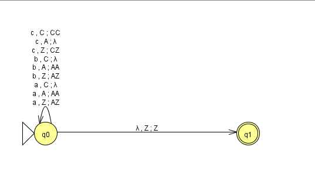

Метка `a, Z; AZ` означает: прочитать `a`, снять `Z`, положить `AZ`. Обозначение $\lambda$ на графе JFLAP соответствует пустой строке $\varepsilon$.

### 3.4. Обоснование корректности

После чтения любого префикса $u$ рабочая ветвь в $q_0$ имеет магазин

$$
\begin{cases}
A^{d(u)}Z,&d(u)>0,\\
Z,&d(u)=0,\\
C^{-d(u)}Z,&d(u)<0.
\end{cases}
$$

До чтения входа $d(\varepsilon)=0$ и магазин равен `Z`. Каждый переход по `a` или `b` увеличивает разность на один, а по `c` уменьшает на один; таблица меняет магазин именно так. Следовательно, инвариант сохраняется по индукции по длине прочитанного префикса.

Если $w\in L_9$, после чтения всей цепочки магазин равен `Z` и доступен переход в $q_1$, поэтому цепочка принимается. Обратно, попасть в $q_1$ можно только при магазине `Z`. Для принятия требуется прочитать весь вход, поэтому из инварианта следует $n_a(w)+n_b(w)=n_c(w)$. Значит, МПА распознаёт в точности $L_9$.

### 3.5. Пошаговое распознавание

Для `ccab` сначала накапливается избыток символов `c`:

$$
(q_0,ccab,Z)\vdash(q_0,cab,CZ)\vdash(q_0,ab,CCZ)
\vdash(q_0,b,CZ)\vdash(q_0,\varepsilon,Z)
\vdash(q_1,\varepsilon,Z).
$$

После двух символов магазин равен `CCZ`:

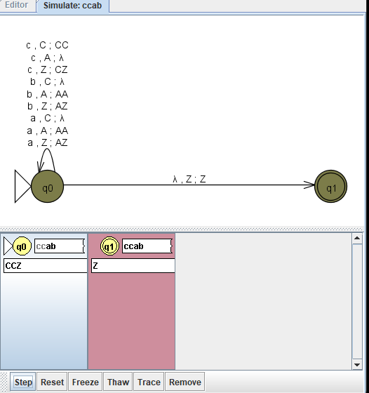

После чтения всей цепочки она принимается:

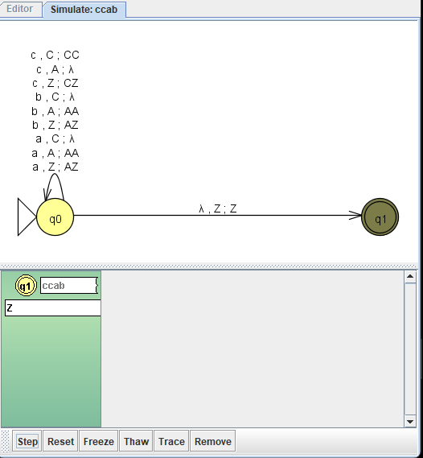

Для `abcc` сначала накапливаются символы `A`:

$$
(q_0,abcc,Z)\vdash(q_0,bcc,AZ)\vdash(q_0,cc,AAZ)
\vdash(q_0,c,AZ)\vdash(q_0,\varepsilon,Z)
\vdash(q_1,\varepsilon,Z).
$$

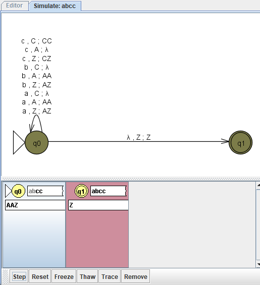

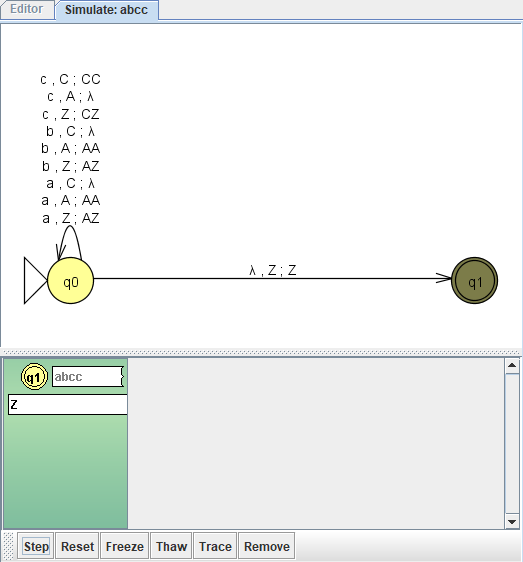

Для `abc` после чтения входа остаётся `AZ`. Переход в финальное состояние недоступен, поэтому цепочка отклоняется:

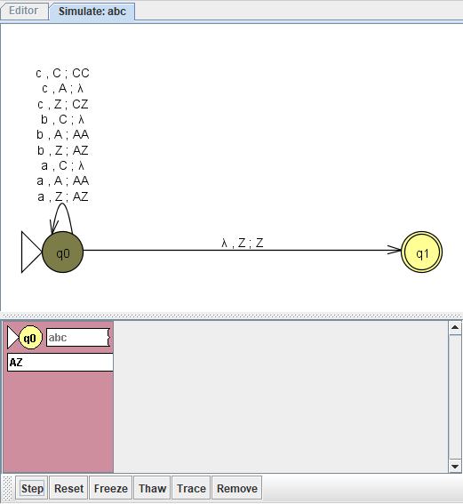

### 3.6. Проверка набора цепочек

| Цепочка | $n_a+n_b$ | $n_c$ | JFLAP |
| --- | --- | --- | --- |
| $\varepsilon$ | 0 | 0 | Accept |
| `ac` | 1 | 1 | Accept |
| `ca` | 1 | 1 | Accept |
| `bc` | 1 | 1 | Accept |
| `abcc` | 2 | 2 | Accept |
| `ccab` | 2 | 2 | Accept |
| `cacb` | 2 | 2 | Accept |
| `abc` | 2 | 1 | Reject |
| `cc` | 0 | 2 | Reject |
| `aabccc` | 3 | 3 | Accept |
| `abccc` | 2 | 3 | Reject |

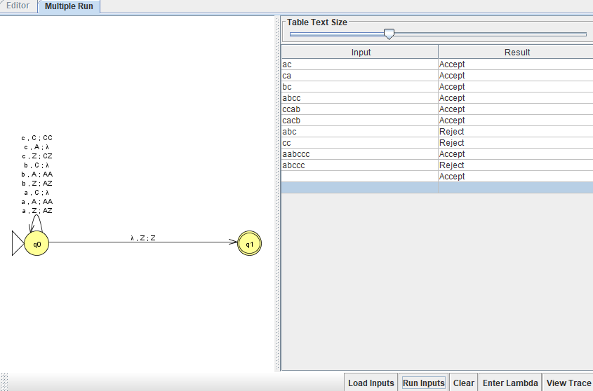

## 4. Часть 2. КСГ для языка $L_{25}$

### 4.1. Полученная грамматика

Построим грамматику

$$
G=(V,T,R,S),\qquad V=\{S,E,C,A,D,B,K\},\quad T=\{a,b,c\}.
$$

Начальный символ — `S`. Правила $R$:

```text
S -> EC | AD
E -> aEb | ε
C -> cC | ε
A -> aA | ε
D -> bDc | B | K
B -> bB | b
K -> cK | c
```

В JFLAP каждую альтернативу записываем отдельной строкой, а для $\varepsilon$ оставляем правую часть пустой. Файл — `grammar.jff`.

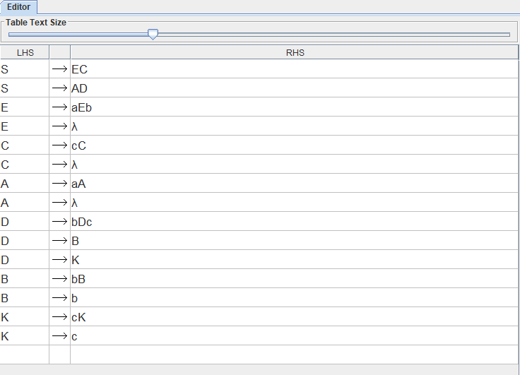

### 4.2. Почему грамматика задаёт нужный язык

| Нетерминал | Порождаемые цепочки | Назначение |
|---|---|---|
| `E` | $a^n b^n$, $n\ge0$ | равное количество `a` и `b` |
| `C` | $c^k$, $k\ge0$ | произвольный блок `c` |
| `A` | $a^n$, $n\ge0$ | произвольный блок `a` |
| `B` | $b^r$, $r\ge1$ | хотя бы один лишний `b` |
| `K` | $c^r$, $r\ge1$ | хотя бы один лишний `c` |
| `D` | $b^m c^k$, $m\ne k$ | неравные блоки `b` и `c` |

Ветка `S -> EC` порождает все цепочки $a^n b^n c^k$ и соответствует условию $n=m$.

В ветке `S -> AD` количество `a` произвольное. После $t\ge0$ применений `D -> bDc` получаем $b^t D c^t$. Завершение через `B` даёт $b^{t+r}c^t$, то есть $m>k$, а завершение через `K` даёт $b^t c^{t+r}$, то есть $m<k$, где $r\ge1$. Поэтому эта ветка порождает только цепочки с $m\ne k$.

Обратно, при $m>k$ можно взять $t=k$, $r=m-k$; при $m<k$ — $t=m$, $r=k-m$. Значит, ветка `AD` порождает все цепочки второй части языка. Объединение веток `EC` и `AD` задаёт в точности $L_{25}$. Все левые части правил состоят из одного нетерминала, поэтому грамматика контекстно-свободная.

### 4.3. Примеры выводов и распознавание в JFLAP

Для `aabbc` выполняется $n=m=2$. Возможен вывод:

```text
S => EC => aEbC => aaEbbC => aabbC => aabbcC => aabbc
```

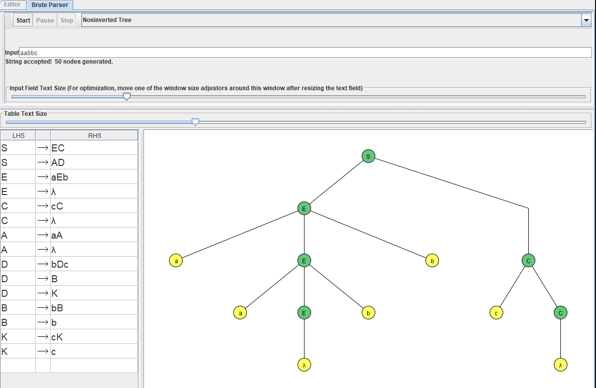

Для `abbbc` выполняется $m=3>k=1$:

```text
S => AD => aAD => aD => abDc => abBc => abbBc => abbbc
```

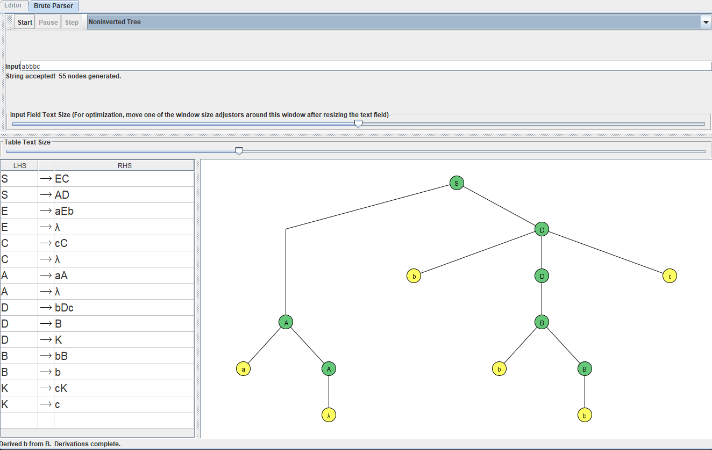

Для `abbccc` выполняется $m=2<k=3$ и $n\ne m$:

```text
S => AD => aAD => aD => abDc => abbDcc => abbKcc => abbccc
```

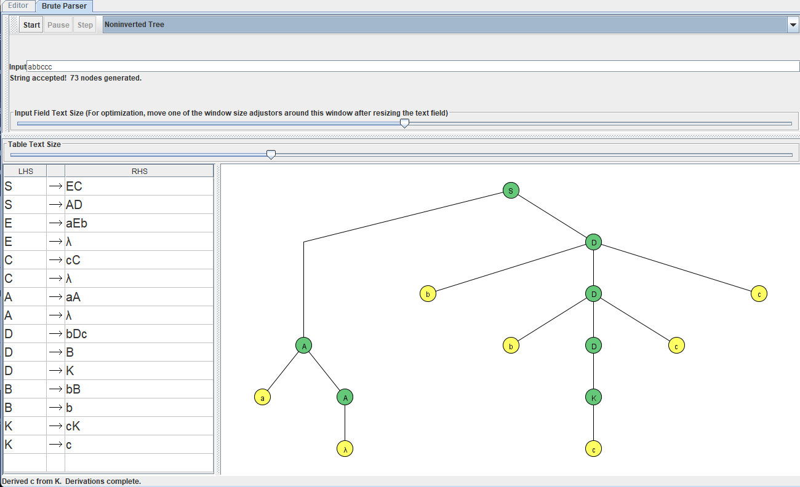

Цепочка `abbcc` отклоняется: $n=1\ne m=2$, а $m=k=2$. Ни одно условие не выполнено.

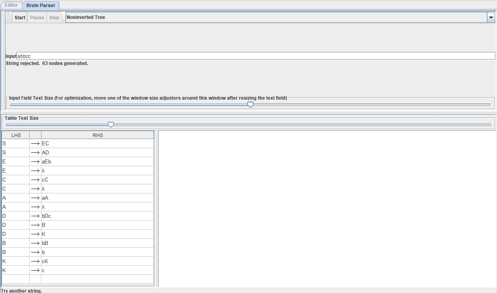

Пустая цепочка также порождается: `S => EC => C => ε`.

| Цепочка | $n,m,k$ | Результат | Причина |
|---|---|---|---|
| $\varepsilon$ | 0, 0, 0 | Accept | $n=m$ |
| `aabbc` | 2, 2, 1 | Accept | $n=m$ |
| `aabbcc` | 2, 2, 2 | Accept | $n=m$, хотя $m=k$ |
| `abbbc` | 1, 3, 1 | Accept | $m>k$ |
| `abbccc` | 1, 2, 3 | Accept | $m<k$ |
| `cc` | 0, 0, 2 | Accept | $n=m$ |
| `a` | 1, 0, 0 | Reject | $n\ne m$ и $m=k$ |
| `bc` | 0, 1, 1 | Reject | $n\ne m$ и $m=k$ |
| `abbcc` | 1, 2, 2 | Reject | $n\ne m$ и $m=k$ |
| `acb` | — | Reject | нарушен порядок блоков |

## 5. Часть 3. Доказательство того, что $L_{41}$ не является КСЯ

### 5.1. Предположение и лемма о разрастании

Предположим противное: язык

$$
L_{41}=\{a^n b^j\mid n\le j^2\}
$$

контекстно-свободный. Тогда существует целое число разрастания $p\ge1$: любую цепочку $s\in L_{41}$ длины не меньше $p$ можно представить в виде

$$
s=uvxyz,\qquad |vxy|\le p,\qquad |vy|\ge1,
$$

причём для любого целого $i\ge0$ должно выполняться

$$
uv^i xy^i z\in L_{41}.
$$

### 5.2. Выбор цепочки

Возьмём

$$
s=a^{p^2}b^p.
$$

Она принадлежит языку, поскольку $n=p^2=j^2$, и имеет длину $p^2+p\ge p$.

Рассмотрим **произвольное** допустимое разбиение $s=uvxyz$. Обозначим

$$
r=n_a(vy),\qquad t=n_b(vy).
$$

Из условий леммы следует

$$
1\le r+t=|vy|\le|vxy|\le p.
$$

Возможны два случая.

### 5.3. Случай 1: повторяемые части не содержат `b`

Пусть $t=0$. Тогда $r\ge1$. Возьмём $i=2$ и удвоим части `v` и `y`. Они содержат только `a`, поэтому получим

$$
uv^2xy^2z=a^{p^2+r}b^p.
$$

Количество `b` осталось равным $p$, а количество `a` стало больше $p^2$:

$$
p^2+r>p^2.
$$

Следовательно, новая цепочка не принадлежит $L_{41}$.

### 5.4. Случай 2: повторяемые части содержат хотя бы один `b`

Пусть $t\ge1$. Возьмём $i=0$, то есть удалим части `v` и `y`. Удаление сохраняет порядок блоков, поэтому получим

$$
uxz=a^{p^2-r}b^{p-t}.
$$

Так как $r+t\le p$ и $t\ge1$, имеем $r\le p-1$. Поэтому

$$
p^2-r\ge p^2-p+1.
$$

При этом $0\le p-t\le p-1$, следовательно,

$$
(p-t)^2\le(p-1)^2=p^2-2p+1.
$$

Для $p\ge1$ выполняется

$$
p^2-p+1>p^2-2p+1.
$$

Значит,

$$
p^2-r>(p-t)^2,
$$

то есть условие языка снова нарушено.

### 5.5. Итог доказательства

В обоих случаях для любого допустимого разбиения нашлось значение $i$, при котором разросшаяся цепочка выходит из языка. Это противоречит лемме о разрастании.

**Следовательно, $L_{41}$ не является контекстно-свободным.** Для него нельзя построить КСГ или МПА, распознающий в точности этот язык.

## 6. Тренажёр леммы о разрастании

Для ознакомления с тренажёром JFLAP используется пункт `Context-Free Pumping Lemma` в начальном окне программы. Среди встроенных примеров есть язык $\{a^n b^n c^n\mid n\ge0\}$.

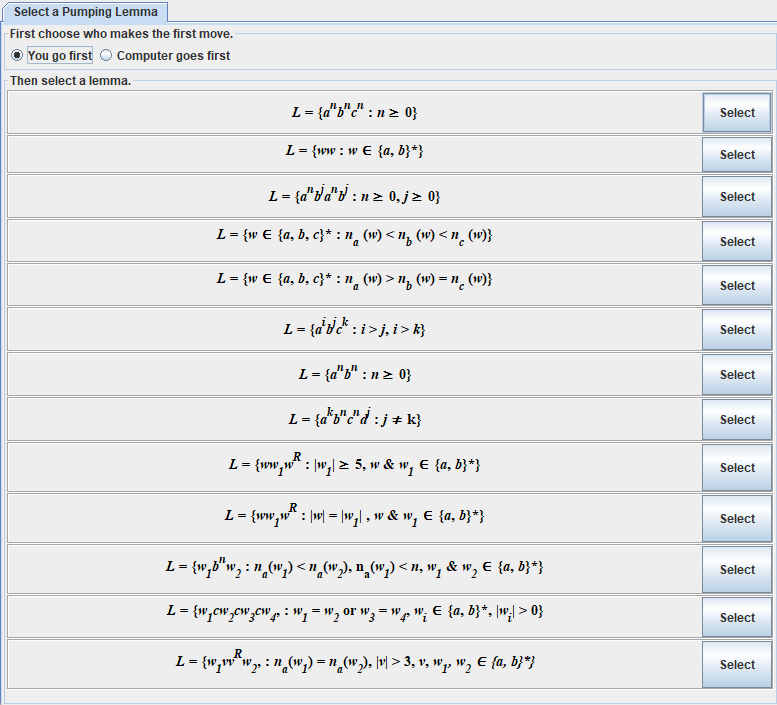

В режиме `You go first` задано число разрастания $p=3$ (поле `m` в JFLAP). Программа выбрала `aaabbbccc`. Для разбиения $u=x=y=\varepsilon$, $v=a$, $z=a^2b^3c^3$ тренажёр выбрал $i=0$ и получил `aabbbccc`, которая не входит в язык:

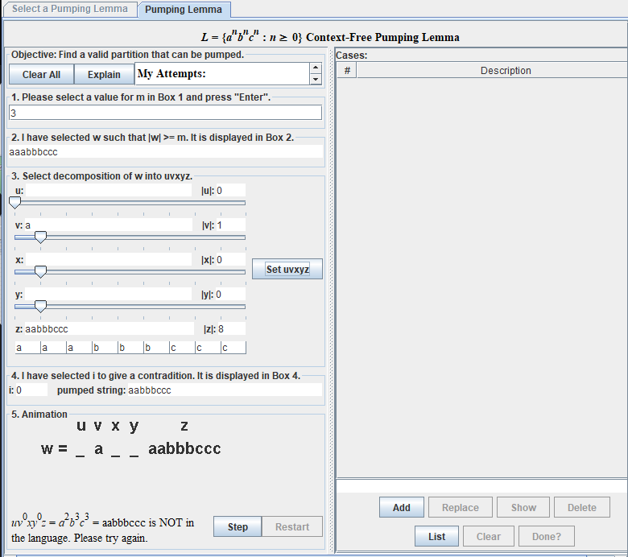

В примере рассматривается цепочка $a^p b^p c^p$. Окно `vxy` длины не более $p$ не может охватить все три блока. При разрастании частей `v` и `y`, хотя бы одна из которых непуста, количества хотя бы одного вида символов меняются, а хотя бы одного другого — остаются прежними. Равенство трёх количеств нарушается; если дополнительно нарушится порядок блоков, цепочка также выйдет из языка.

Этот пример показывает, зачем необходимо рассматривать все допустимые разбиения и почему одного неудачного разбиения недостаточно. Доказательство для собственного варианта приведено отдельно в разделе 5.

## 7. Вывод

Для языка $L_9$ построен МПА с принятием по финальному состоянию. Для $L_{25}$ построена КСГ, учитывающая оба условия объединения. Распознавание проверено на принимаемых и отклоняемых цепочках. С помощью леммы о разрастании доказано, что язык $L_{41}$ не является контекстно-свободным.

## 8. Как запустить работу

### 8.1. МПА в JFLAP

1. Открыть `pda.jff` через `File -> Open`.
2. Выбрать `Input -> Step with Closure`.
3. Ввести, например, `ccab` и подтвердить ввод. В появившемся диалоге `Accept by` выбрать **Final State**.
4. Нажимать `Step` до результата. Если вход уже прочитан, завершить доступный пустой переход в $q_1$.
5. Проверить `abcc` и `abc` аналогичным образом.
6. Для набора входов выбрать `Input -> Multiple Run`, заполнить строки и нажать `Run Inputs`. Для пустой цепочки служит кнопка `Enter Lambda`.

### 8.2. КСГ в JFLAP

1. Открыть `grammar.jff`.
2. Выбрать `Input -> Brute Force Parse`.
3. Ввести `aabbc`, нажать `Start`, дождаться результата.
4. Нажимать `Step`, чтобы раскрыть дерево вывода. Вариант отображения `Derivation Table` показывает последовательность выводов.
5. Аналогично проверить `abbbc`, `abbccc` и отклоняемую `abbcc`.
6. Для самостоятельного выбора правил использовать `Input -> User Control Parse`.
