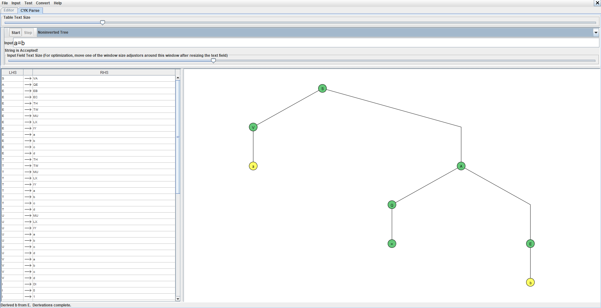
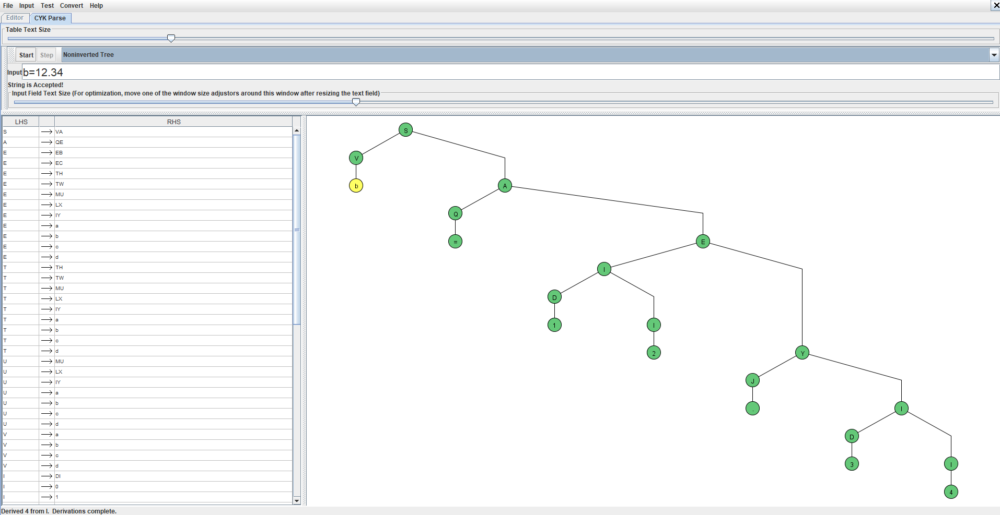
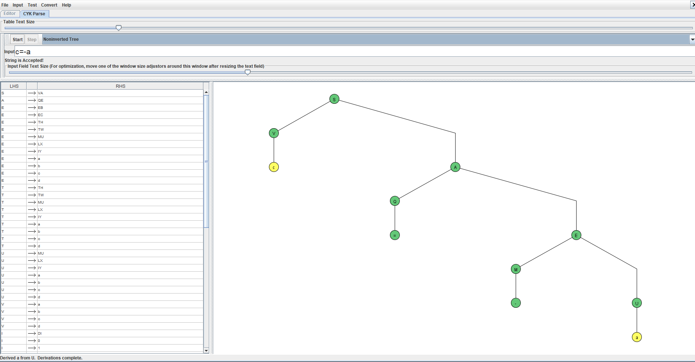
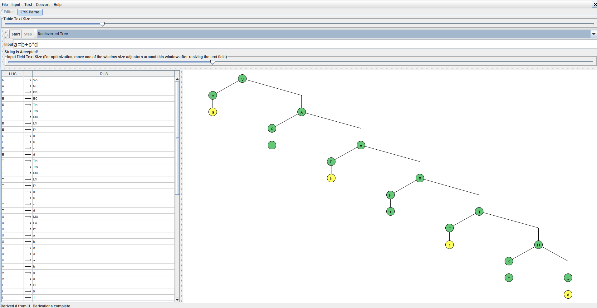
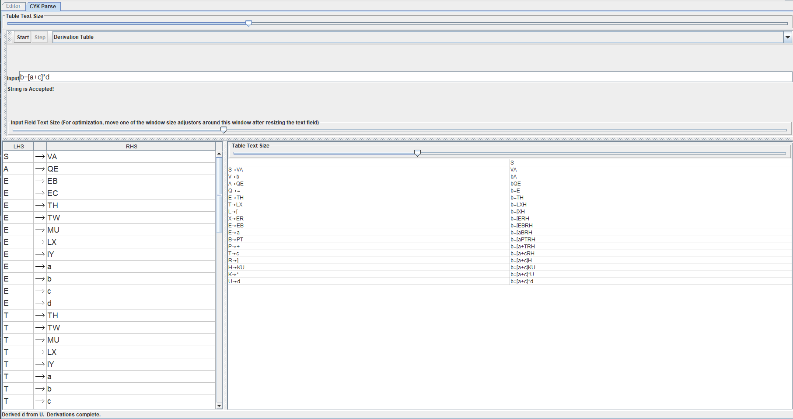
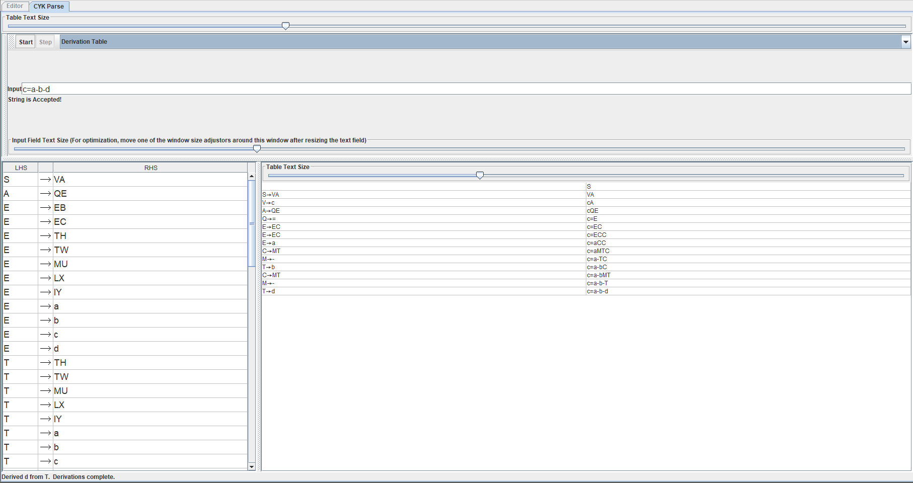
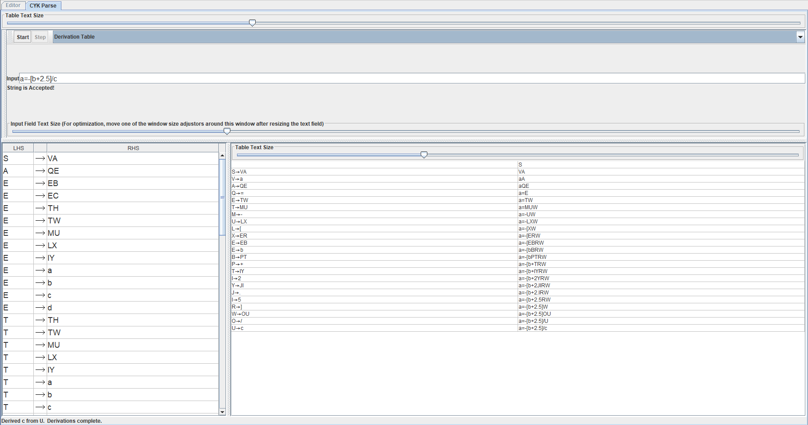
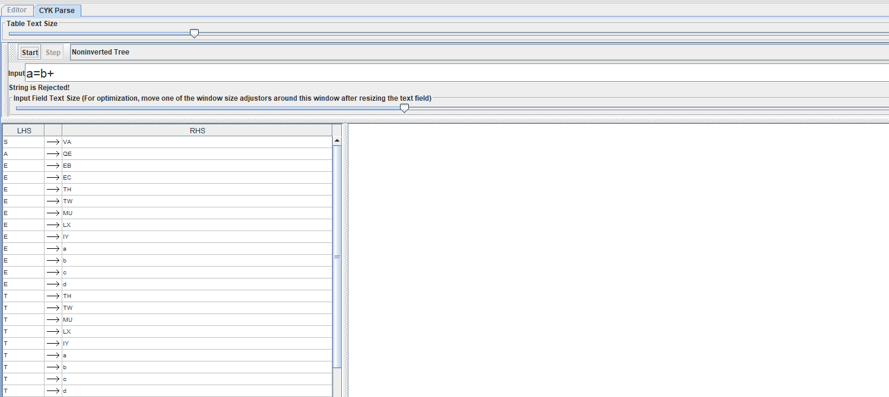
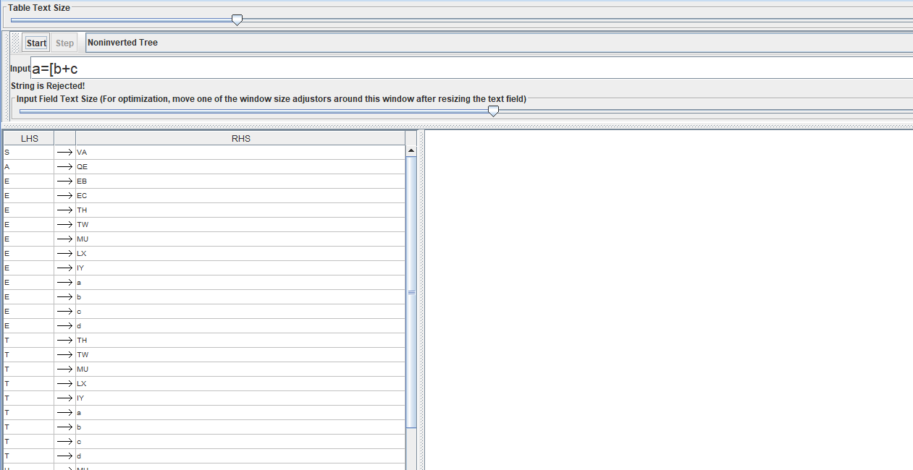
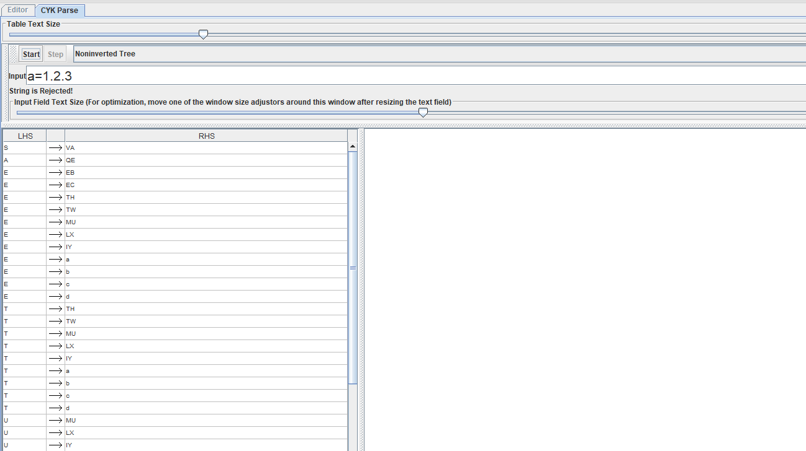

# Практическая работа № 4. Синтаксический анализ контекстно-свободных языков

**Дисциплина:** Теория автоматов, языков и вычислений  
**Вариант:** 4  
**Выполнила:** Греб Д.С., КИ24-16/2Б  
**Проверил:** Кузнецов А.С.  
**Город, год:** Красноярск, 2026

## 1. Цель работы и постановка задачи

**Цель работы:** исследование свойств универсальных алгоритмов синтаксического анализа контекстно-свободных языков.

**Задание, вариант 4:** построить в JFLAP КСГ языка оператора присваивания с арифметическим выражением справа. Выражения содержат вещественные константы без экспоненты, однобуквенные переменные `a`–`d`, знаки операций и скобки. Приоритет операций от высшего к низшему: унарный минус; умножение и деление; сложение и вычитание; присваивание. Получить грамматику в НФХ и проверить цепочки методом Кока-Янгера-Касами.

В модели присваивание обозначено `=`, числа записываются с точкой и хотя бы одной цифрой с каждой стороны, например `12.34`. Цепочки вводятся без пробелов. Для группировки используются `[]`, поскольку CYK-режим JFLAP 7.1 резервирует символы `(` и `)`.

В ходе работы задаются правила построения допустимых выражений, записывается грамматика в нормальной форме Хомского и проверяются правильные и ошибочные цепочки. Результат работы — JFLAP-модель, которая определяет, соответствует ли запись заданному синтаксису, и позволяет получить дерево ее разбора. Вычисление значений выражений в эту задачу не входит.

## 2. Полученная КСГ в НФХ

Файл модели: [grammar_cnf.jff](grammar_cnf.jff). Начальный символ: `S`.

### 2.1. Формальное задание грамматики

Контекстно-свободная грамматика задается четверкой:

$$
G=(N,\Sigma,\mathcal{P},S).
$$

| Обозначение | Значение в работе |
|---|---|
| $G$ | Грамматика, задающая правила построения операторов присваивания |
| $N$ | Конечное множество нетерминалов — вспомогательных символов, обозначающих части конструкции, например выражение или последовательность цифр |
| $\Sigma$ (сигма) | Терминальный алфавит — символы, из которых состоит готовая входная цепочка: буквы переменных, цифры, знаки операций, скобки и точка |
| $\mathcal{P}$ | Конечное множество правил, или продукций. Правило указывает, какой последовательностью символов можно заменить нетерминал |
| $S$ | Начальный нетерминал, с которого начинается построение полного оператора присваивания |

Нетерминалы постепенно заменяются по правилам. Когда в полученной записи остаются только терминалы, она является цепочкой языка. В КСГ слева в каждом правиле находится ровно один нетерминал.

Множество нетерминалов модели:

$$
N=\{S,A,E,T,U,V,I,D,B,C,H,W,X,Y,P,M,K,O,Q,L,R,J\},
$$

Терминальный алфавит:

$$
\Sigma=\{a,b,c,d,0,1,2,3,4,5,6,7,8,9,=,+,-,*,/,[,],.\}.
$$

Например, строчная `a` является терминалом и может входить в проверяемое выражение. Прописная `E` является нетерминалом: она обозначает выражение и при выводе должна быть заменена.

### 2.2. Правила грамматики

Множество продукций $\mathcal{P}$:

```text
S -> VA
A -> QE
E -> EB | EC | TH | TW | MU | LX | IY | a | b | c | d
T -> TH | TW | MU | LX | IY | a | b | c | d
U -> MU | LX | IY | a | b | c | d
V -> a | b | c | d
I -> DI | 0 | 1 | 2 | 3 | 4 | 5 | 6 | 7 | 8 | 9
D -> 0 | 1 | 2 | 3 | 4 | 5 | 6 | 7 | 8 | 9
B -> PT
C -> MT
H -> KU
W -> OU
X -> ER
Y -> JI
P -> +
M -> -
K -> *
O -> /
Q -> =
L -> [
R -> ]
J -> .
```

Стрелка `->` означает замену нетерминала слева символами справа. Знак `|` разделяет альтернативы: например, `V -> a | b | c | d` обозначает четыре отдельных правила. Сами стрелки и разделители альтернатив во входные цепочки не входят.

### 2.3. Назначение нетерминалов

| Нетерминал | Что задает |
|---|---|
| `S` | Полный оператор присваивания |
| `V` | Имя переменной: одну букву от `a` до `d` |
| `A` | Часть присваивания после имени переменной: знак `=` и выражение |
| `E` | Арифметическое выражение с возможными сложениями и вычитаниями |
| `T` | Терм: выражение с возможными умножениями и делениями; сложение и вычитание внутри него требуют скобок |
| `U` | Переменную, число или выражение в скобках, перед которыми могут стоять унарные минусы |
| `I` | Непустую последовательность десятичных цифр |
| `D` | Одну десятичную цифру |
| `B` | Знак `+` и следующий за ним терм |
| `C` | Знак `-` и следующий за ним терм |
| `H` | Знак `*` и следующий за ним операнд уровня `U` |
| `W` | Знак `/` и следующий за ним операнд уровня `U` |
| `X` | Выражение и закрывающую скобку `]` |
| `Y` | Десятичную точку и непустую дробную часть числа |
| `P` | Терминал `+` |
| `M` | Терминал `-` |
| `K` | Терминал `*` |
| `O` | Терминал `/` |
| `Q` | Терминал `=` |
| `L` | Терминал `[` |
| `R` | Терминал `]` |
| `J` | Терминал `.` |

В правилах `P` — имя нетерминала для знака сложения; множество всех продукций обозначено отдельно как $\mathcal{P}$.

Правила `S -> VA` и `A -> QE` вместе задают конструкцию «переменная, знак присваивания, выражение». Например, цепочка `a=b` получается следующим выводом:

```text
S => VA => aA => aQE => a=E => a=b
```

Каждый знак `=>` здесь обозначает одно применение правила. В конце остались только терминалы `a`, `=` и `b`.

Число строится через `IY`: первый `I` задает целую часть, а `Y -> JI` добавляет точку и дробную часть. Правило `I -> DI` позволяет наращивать последовательность цифр, а терминальные правила для `I` завершают ее. Поэтому модель допускает, например, `12.34`, но отклоняет `1.2.3`.

Приоритет операций задается уровнями `E`, `T` и `U`. Например, правила `E -> EB` и `B -> PT` задают сложение выражения и терма, а `T -> TH` и `H -> KU` задают умножение. Поэтому в `a=b+c*d` произведение `c*d` целиком входит в правый операнд сложения. Конструкция `MU` задает унарный минус, а `LX` вместе с `X -> ER` — выражение в скобках. Левая рекурсия на уровнях `E` и `T` задает левую ассоциативность бинарных операций.

### 2.4. Соответствие нормальной форме Хомского

Для применения алгоритма Кока-Янгера-Касами грамматика записана в нормальной форме Хомского. В этой форме используются правила двух видов:

$$
A \to BC \qquad \text{или} \qquad A \to t.
$$

Здесь $A$, $B$ и $C$ — условные обозначения произвольных нетерминалов, а $t$ — одного терминала. Первое правило разбивает конструкцию на две части, второе задает один символ готовой цепочки. Например, `S -> VA` соответствует первому виду, а `V -> a` — второму.

При приведении к НФХ терминалы в составных конструкциях вынесены в отдельные правила, а длинные правые части разбиты на пары нетерминалов. Например, конструкция `V=E` представлена правилами `S -> VA`, `A -> QE` и `Q -> =`. Правила с единственным нетерминалом справа устранены переносом его альтернатив.

В полученной грамматике 22 нетерминала и 68 отдельных продукций. В каждом правиле справа находятся два нетерминала либо один терминал. Правил с пустой правой частью или с единственным нетерминалом справа нет; начальный символ `S` справа не встречается. Следовательно, модель соответствует НФХ и пригодна для CYK-анализа.

## 3. Распознавание тестовых цепочек методом Кока-Янгера-Касами

Проверка выполнена в JFLAP 7.1: `grammar_cnf.jff` → `Input` → `CYK Parse`.

Алгоритм сначала определяет, из каких нетерминалов выводятся отдельные символы цепочки. Затем он рассматривает все разбиения более длинных подстрок на две непустые соседние части и применяет правила вида $A \to BC$. Найденные нетерминалы сохраняются в таблице. Цепочка принимается, если среди нетерминалов, порождающих всю цепочку, найден начальный символ `S`.

После ввода цепочки и нажатия `Start` JFLAP показывает результат распознавания. В тестах 1–4 кнопкой `Step` раскрыто дерево разбора: его корень — `S`, промежуточные узлы показывают примененные правила, а листья образуют введенную цепочку. В тестах 5–7 выбран режим `Derivation Table`: слева указано примененное правило, справа — цепочка после его применения. Вывод начинается с `S` и заканчивается введенной цепочкой. Это таблица вывода, полученного по результатам CYK-анализа. Дерево и последовательность правил позволяют проверить группировку операций. Ниже приведены семь принимаемых и три отклоняемые цепочки.

**1. `a=b` — цепочка принята.**

Проверяется простейшее присваивание: слева и справа находятся допустимые переменные, между ними — знак `=`. Дерево показывает вывод полного оператора из `S`.



**2. `b=12.34` — цепочка принята.**

Проверяется вещественная константа с многозначными целой и дробной частями. В дереве число строится из двух последовательностей цифр, разделенных одной точкой.



**3. `c=-a` — цепочка принята.**

Проверяется унарный минус перед переменной. Знак `-` и операнд образуют одну конструкцию по правилу `E -> MU`.



**4. `a=b+c*d` — цепочка принята.**

Проверяется приоритет умножения над сложением. В дереве подвыражение `c*d` образует терм, который затем складывается с `b`.



**5. `b=[a+c]*d` — цепочка принята.**

Проверяется изменение порядка действий с помощью скобок. В таблице правило `E -> TH` задает умножение, а `T -> LX` и `X -> ER` выделяют его левый операнд в скобках. Внутри них выводится сумма `a+c`, после чего `H` раскрывается в `*d`. Последняя строка таблицы содержит `b=[a+c]*d`.



**6. `c=a-b-d` — цепочка принята.**

Проверяется левая ассоциативность вычитания. В таблице два применения `E -> EC` дают конструкцию `ECC`: внутреннее выражение образует разность `a-b`, а внешний суффикс задает вычитание `d`. Поэтому группировка соответствует `(a-b)-d`. Круглые скобки здесь поясняют структуру и не являются частью входной цепочки. Последняя строка таблицы содержит `c=a-b-d`.



**7. `a=-[b+2.5]/c` — цепочка принята.**

Совместно проверяются вещественная константа, сложение в скобках, унарный минус и деление. В таблице правило `E -> TW` задает деление, `T -> MU` — унарный минус перед его левым операндом, а `U -> LX` — группу `[b+2.5]`. Конструкция `W` раскрывается в `/c`. Последняя строка таблицы содержит `a=-[b+2.5]/c`.



**8. `a=b+` — цепочка отклонена.**

После знака сложения отсутствует правый операнд. Конструкция `B -> PT` требует непустой терм после `+`, поэтому полная цепочка не выводится из `S`.



**9. `a=[b+c` — цепочка отклонена.**

Отсутствует закрывающая скобка `]`. Правила `E -> LX` и `X -> ER` требуют обе скобки, поэтому корректную группирующую конструкцию построить невозможно.



**10. `a=1.2.3` — цепочка отклонена.**

В записи числа две десятичные точки. Конструкция `IY` с правилом `Y -> JI` допускает ровно одну точку, а смежные числа без знака операции также не образуют выражение.



Таким образом, в JFLAP получены ожидаемые результаты для всех десяти цепочек. Принимаемые примеры подтверждают работу основных конструкций и заданную группировку операций, отклоняемые — обнаружение рассмотренных синтаксических ошибок.

