# Практическая работа № 5. Синтаксический анализ контекстно-свободных языков

**Дисциплина:** Теория автоматов, языков и вычислений  
**Вариант:** 8  
**Выполнила:** Греб Д.С., КИ24-16/2Б  
**Проверил:** Фарафонов М. М.  
**Город, год:** Красноярск, 2026

## 1. Цель работы и постановка задачи

**Цель:** исследовать LL(1)- и SLR(1)-грамматики, построить соответствующие модели синтаксического анализа и реализовать метод рекурсивного спуска.

**Вариант 8:**

1. **Часть 1:** создать в JFLAP LL(1)-грамматику одного оператора присваивания, в правой части которого используются временные значения двух форматов, переменные `b`–`e`, унарная и бинарные операции, скобки.
2. **Часть 2:** реализовать анализатор рекурсивного спуска для последовательностей выражений, включающих время двух форматов, десятичные целые числа, переменные из 1–2 символов, операции и присваивание. Результат — `Accepted` либо `Rejected`.
3. **Часть 3:** создать в JFLAP SLR(1)-грамматику последовательностей операторов присваивания, в правой части которых допустимы временные значения двух форматов, целые числа, переменные `b`–`e` и операции.

В частях 1–2 выбраны форматы времени суток `HH:MM` и `HH.MM` (00–23 часа, 00–59 минут); операции `-` (унарная), `+`, `-`, `*`, `/` (бинарные) и `=`. В части 3 для упрощения посимвольной грамматики выбраны форматы временных длительностей `Nh` (часы) и `Nm` (минуты), унарный `-` и бинарные `+`, `-`. В третьей части `N` — непустая последовательность десятичных цифр. Присваивание обозначается `=`, разделитель последовательности — `;`, группирующие скобки — `[` и `]`. Для разных частей конструируются **разные грамматики**. Бонусное восстановление после ошибок не выполняется.

## 2. Краткие теоретические сведения

Контекстно-свободная грамматика задаётся четвёркой $G=(N,\Sigma,P,S)$, где $N$ — множество нетерминалов, $\Sigma$ — терминальный алфавит, $P$ — правила, $S$ — начальный символ. Множество **FIRST** указывает возможные начальные терминалы выводимой цепочки; **FOLLOW** — терминалы, которые могут следовать после нетерминала; `$` обозначает конец ввода, $\varepsilon$ — пустую цепочку.

**LL(1)** — нисходящий анализ слева направо с построением левого вывода и одним символом предпросмотра. Для каждой пары «нетерминал — следующий символ» таблица должна определять не более одной продукции. Метод рекурсивного спуска реализует разбор вызовами функций, соответствующих правилам грамматики.

**SLR(1)** — восходящий разбор «перенос–свёртка». Его таблица строится из канонического набора LR(0)-ситуаций и множеств FOLLOW: `ACTION` определяет перенос (`s`), свёртку (`r`), принятие (`acc`) или ошибку; `GOTO` задаёт переходы по нетерминалам. Отсутствие конфликтов переноса/свёртки и свёртки/свёртки подтверждает принадлежность грамматики классу SLR(1).

## 3. Часть 1. LL(1)-грамматика

**Файл модели:** [`grammar_ll1.jff`](grammar_ll1.jff). Аксиома — `S`; $\varepsilon$ в JFLAP обозначается пустой правой частью.

### 3.1. Правила грамматики

```text
S -> V=E
V -> b | c | d | e
E -> TX
X -> +TX | -TX | ε
T -> UY
Y -> *UY | /UY | ε
U -> -U | F
F -> V | [E] | W
W -> HCM
H -> 0D | 1D | 2B
B -> 0 | 1 | 2 | 3
C -> : | .
M -> 0D | 1D | 2D | 3D | 4D | 5D
D -> 0 | 1 | 2 | 3 | 4 | 5 | 6 | 7 | 8 | 9
```

`V` — имя переменной; `E`, `T`, `U` — уровни приоритета операций; `X`, `Y` — продолжения выражений; `F` — операнд; `W`, `H`, `M`, `C`, `B`, `D` — запись времени. Правила `H → 2B` и `M → 0D | ... | 5D` не допускают `24:00` и `12:60`. Левая рекурсия устранена, чтобы грамматика была пригодна для LL(1)-разбора; бинарные цепочки в её дереве имеют правую группировку.

### 3.2. Множества FIRST и FOLLOW

| Нетерминал | FIRST | FOLLOW |
|---|---|---|
| `S` | `b c d e` | `$` |
| `V` | `b c d e` | `$ * + - / = ]` |
| `E` | `- 0 1 2 [ b c d e` | `$ ]` |
| `X` | `ε + -` | `$ ]` |
| `T` | `- 0 1 2 [ b c d e` | `$ + - ]` |
| `Y` | `ε * /` | `$ + - ]` |
| `U` | `- 0 1 2 [ b c d e` | `$ * + - / ]` |
| `F` | `0 1 2 [ b c d e` | `$ * + - / ]` |
| `W` | `0 1 2` | `$ * + - / ]` |
| `H` | `0 1 2` | `. :` |
| `B` | `0 1 2 3` | `. :` |
| `C` | `. :` | `0 1 2 3 4 5` |
| `M` | `0 1 2 3 4 5` | `$ * + - / ]` |
| `D` | `0 1 2 3 4 5 6 7 8 9` | `$ * + - . / : ]` |

### 3.3. Таблица предсказывающего анализа LL(1)

Ниже дано **сжатое представление** таблицы $M[A,a]$: группы символов обозначают несколько клеток с одной продукцией. Для обозначения `i∈0…9` имеется в виду **отдельная клетка для каждого** значения `i`. Все остальные клетки означают ошибку.

| A | Символ предпросмотра a | M[A,a] |
|---|---|---|
| `S` | `b c d e` | `S → V=E` |
| `V` | `b`, `c`, `d`, `e` соответственно | `V → b`, `V → c`, `V → d`, `V → e` |
| `E` | `- 0 1 2 [ b c d e` | `E → TX` |
| `X` | `+` / `-` / `$ ]` | `X → +TX` / `X → -TX` / `X → ε` |
| `T` | `- 0 1 2 [ b c d e` | `T → UY` |
| `Y` | `*` / `/` / `$ + - ]` | `Y → *UY` / `Y → /UY` / `Y → ε` |
| `U` | `-` / `0 1 2 [ b c d e` | `U → -U` / `U → F` |
| `F` | `b c d e` / `[` / `0 1 2` | `F → V` / `F → [E]` / `F → W` |
| `W` | `0 1 2` | `W → HCM` |
| `H` | `0` / `1` / `2` | `H → 0D` / `H → 1D` / `H → 2B` |
| `B` | `i∈0…3` | `B → i` |
| `C` | `:` / `.` | `C → :` / `C → .` |
| `M` | `i∈0…5` | `M → iD` |
| `D` | `i∈0…9` | `D → i` |

**Формальное обоснование LL(1).** Альтернативы для `V`, `B`, `C`, `D`, `H`, `M` имеют попарно непересекающиеся FIRST. У `F` множества FIRST альтернатив равны `{b,c,d,e}`, `{[}` и `{0,1,2}`; у `U` — `{-}` и `FIRST(F)`, поэтому пересечений также нет. Для `X` терминальные варианты начинаются с `+` и `-`, а `FOLLOW(X)={$ , ]}`; для `Y` — с `*` и `/`, а `FOLLOW(Y)={$,+,-,]}`. Таким образом, FIRST непустых альтернатив не пересекаются с FOLLOW при выборе $\varepsilon$. В таблице отсутствуют неоднозначные клетки, следовательно, грамматика **LL(1)**.

### 3.4. Проверка цепочек в JFLAP

В JFLAP (`Input → Build LL(1) Parse Table → Do All → Parse`) проверены четыре корректные и две некорректные цепочки.

| № | Цепочка | Результат | Что проверяется |
|---:|---|---|---|
| 1 | `b=12:30` | Accepted | Формат `HH:MM` |
| 2 | `c=23.59` | Accepted | Формат `HH.MM`, верхняя граница времени |
| 3 | `d=b+03:15*e` | Accepted | Приоритет умножения перед сложением |
| 4 | `e=-00:00` | Accepted | Унарный минус |
| 5 | `b=24:00` | Rejected | Часы за пределами допустимого диапазона |
| 6 | `b=12:30+` | Rejected | Отсутствие операнда после бинарного знака |

**1. `b=12:30` — принято.** Дерево включает присваивание и время в формате `HH:MM`.

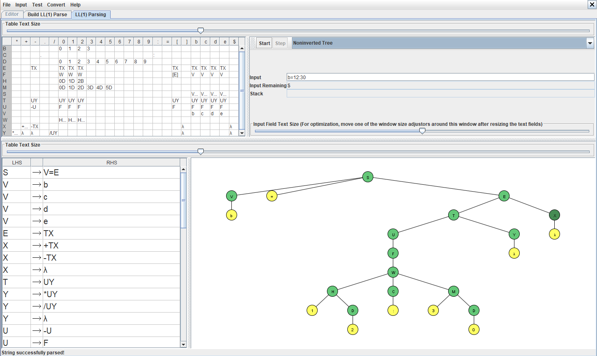

**2. `c=23.59` — принято.** Проверяется второй формат временной константы.

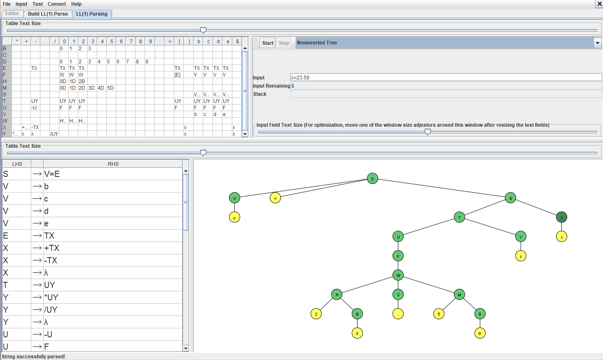

**3. `d=b+03:15*e` — принято.** Умножение формируется внутри терма до сложения.

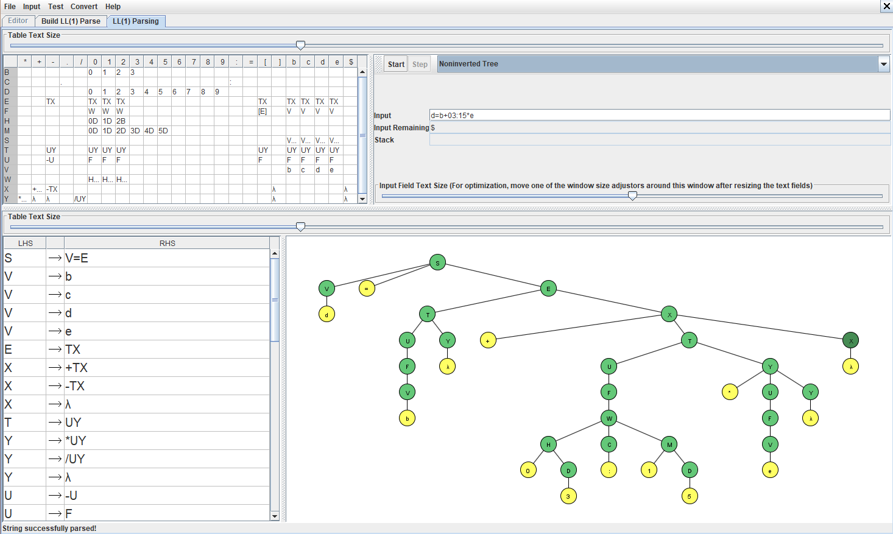

**4. `e=-00:00` — принято.** Разобрана унарная операция перед временным значением.

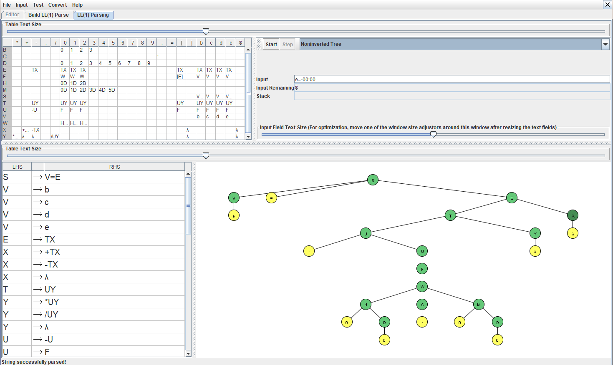

**5. `b=24:00` — отклонено.** Продукции `H` не допускают час `24`.

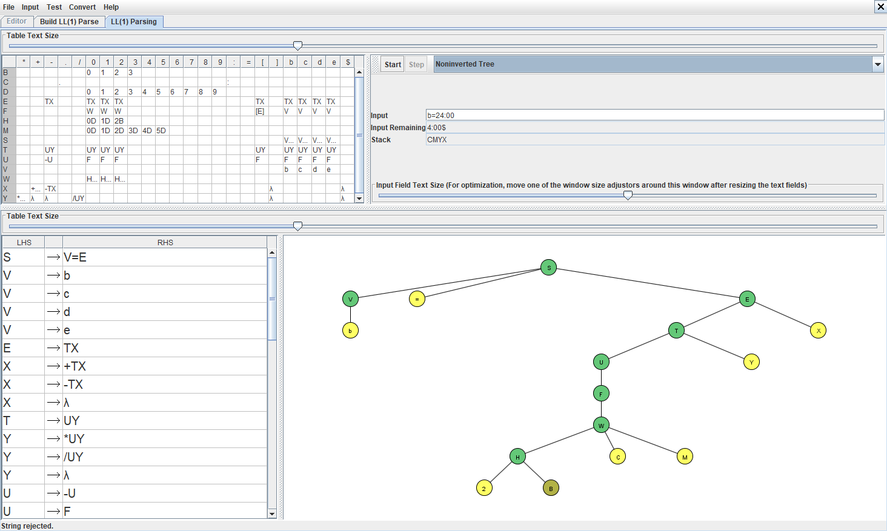

**6. `b=12:30+` — отклонено.** После плюса отсутствует обязательный терм.

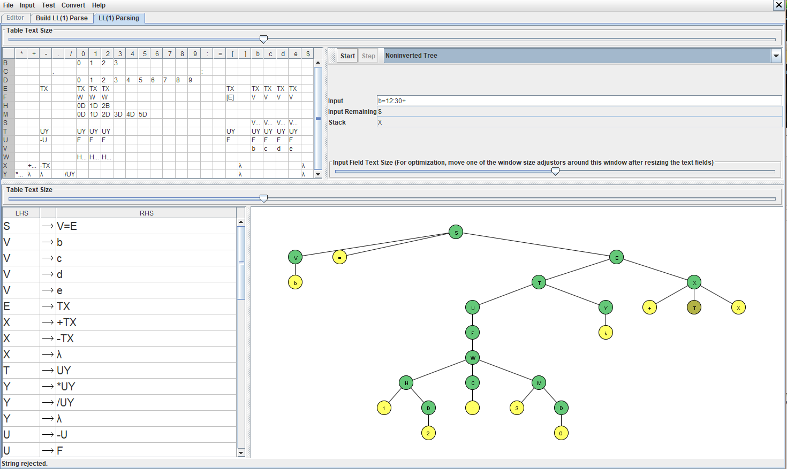

**FIRST, FOLLOW и таблица LL(1), построенные JFLAP:**

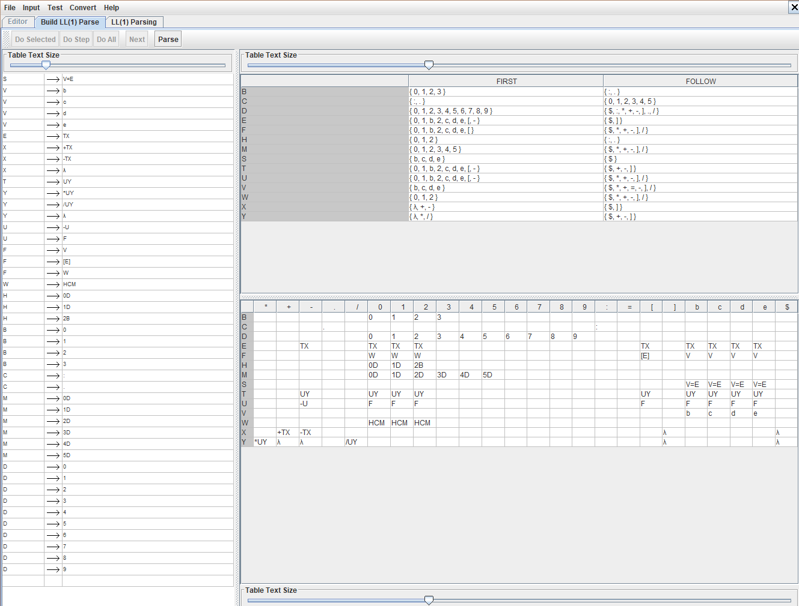

## 4. Часть 2. Метод рекурсивного спуска

**Файл:** [`recursive_descent.py`](recursive_descent.py), Python 3; сторонние библиотеки не используются. Программа проверяет синтаксис, не вычисляя значения выражений.

### 4.1. Грамматика анализатора

Лексер выделяет пять типов токенов: `TIME` (`HH:MM` или `HH.MM`), `INT` (десятичное целое), `ID` (имя из одной-двух латинских букв), отдельные знаки операций и конец строки `$`. Пробелы игнорируются. Время проверяется до распознавания целого числа.

```text
P -> E R
R -> ; E R | ε
E -> ID N | - U Y X | [ E ] Y X | TIME Y X | INT Y X
N -> = E | Y X
X -> + T X | - T X | ε
T -> U Y
Y -> * U Y | / U Y | ε
U -> - U | F
F -> ID | TIME | INT | [ E ]
```

Здесь `P` задаёт непустую последовательность выражений, `R` — её продолжение, `N` выбирает между присваиванием `=E` и арифметическим продолжением. Присваивание правоассоциативно: `a=b=c` допустимо, тогда как `a+b=c` отклоняется, поскольку слева от `=` допускается только отдельное имя переменной.

### 4.2. Доказательство LL(1)

| A | FIRST(A) | FOLLOW(A) |
|---|---|---|
| `P` | `ID INT TIME - [` | `$` |
| `R` | `; ε` | `$` |
| `E` | `ID INT TIME - [` | `$ ; ]` |
| `N` | `= * / + - ε` | `$ ; ]` |
| `X` | `+ - ε` | `$ ; ]` |
| `T` | `ID INT TIME - [` | `$ ; ] + -` |
| `Y` | `* / ε` | `$ ; ] + -` |
| `U` | `ID INT TIME - [` | `$ ; ] + - * /` |
| `F` | `ID INT TIME [` | `$ ; ] + - * /` |

Для каждой пары альтернатив выполняются условия LL(1):

- У `E` пять альтернатив начинаются с различных токенов: `ID`, `-`, `[`, `TIME`, `INT`. Аналогично у `F` и у `U` (альтернативы `-U` и `F`).
- У `N` множества FIRST альтернатив `=E` и `YX` равны `{=}` и `{*,/,+,-,ε}`; для пустого вывода `FOLLOW(N)={$ , ;, ]}` не пересекается с `{*,/,+,-}`.
- Для `X`, `Y`, `R` FIRST непустых альтернатив равны соответственно `{+,-}`, `{*,/}`, `{;}` и не пересекаются с FOLLOW соответствующего нетерминала.

Во всех случаях выбор продукции определяется одним следующим токеном. Значит, грамматика относится к классу **LL(1)**. В программе этот выбор выполняют методы `expression`, `term`, `unary`, `factor` и функции обработки продолжений; перебора альтернатив и возврата к уже прочитанному вводу нет.

### 4.3. Результаты тестирования

Запуск из папки `pr5`:

```bash
python recursive_descent.py -e "a=12:30;b=5"
# Accepted
```

Протестированы 12 цепочек (6 принимаемых и 6 отклоняемых):

| № | Цепочка | Результат | Проверяемое свойство |
|---:|---|---|---|
| 1 | `a=12:30` | Accepted | Время `HH:MM` |
| 2 | `ab=23.59+5` | Accepted | Имя из 2 букв, время и целое |
| 3 | `x=3;y=10:20` | Accepted | Два выражения через `;` |
| 4 | `a=b=c` | Accepted | Вложенное присваивание |
| 5 | `a=[b=c]+1` | Accepted | Скобки и присваивание внутри выражения |
| 6 | `ab=12:30/[cd-5]` | Accepted | Деление, скобки и вычитание |
| 7 | `a=24:00` | Rejected | Недопустимый час |
| 8 | `abc=10` | Rejected | Имя длиннее 2 символов |
| 9 | `a=1;` | Rejected | Пустое выражение после `;` |
| 10 | `a+b=c` | Rejected | Слева от `=` не отдельное имя |
| 11 | `a=12:30+` | Rejected | Отсутствует операнд |
| 12 | `a=12.30.40` | Rejected | Лишний разделитель времени |

**Положительные результаты (тесты 1–6):**

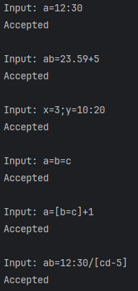

**Отрицательные результаты (тесты 7–12):**

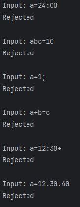

Все 12 результатов соответствуют заданному синтаксису. Для каждой цепочки программа выдаёт только `Accepted` либо `Rejected`; бонусная диагностика и восстановление после ошибок не реализованы.

## 5. Часть 3. SLR(1)-грамматика

**Файл модели:** [`grammar_slr1.jff`](grammar_slr1.jff). Здесь распознаются последовательности **операторов присваивания**, разделённые `;`. Временные величины представлены форматами `Nh` и `Nm` (`12h`, `30m`). В правой части допустимы целые числа, переменные `b`–`e`, операции `+`, `-`, унарный минус и скобки. В левой части присваивания — только одна переменная из `b`–`e`.

### 5.1. Продукции

```text
S -> S;A | A
A -> V=E
V -> b | c | d | e
E -> E+U | E-U | U
U -> -U | [E] | V | N | Nh | Nm
N -> ND | D
D -> 0 | 1 | 2 | 3 | 4 | 5 | 6 | 7 | 8 | 9
```

`S` — последовательность присваиваний, `A` — присваивание, `V` — переменная, `E` — выражение, `U` — операнд с возможным унарным минусом, `N` — непустое десятичное число, `D` — цифра. Левая рекурсия в `E` задаёт левую ассоциативность бинарных операций. Синтаксический анализ не проверяет совместимость типов, только корректность записи.

### 5.2. Множества FIRST и FOLLOW

| Нетерминал | FIRST | FOLLOW |
|---|---|---|
| `S` | `b c d e` | `$ ;` |
| `A` | `b c d e` | `$ ;` |
| `V` | `b c d e` | `$ + - ; = ]` |
| `E` | `- 0 1 2 3 4 5 6 7 8 9 [ b c d e` | `$ + - ; ]` |
| `U` | `- 0 1 2 3 4 5 6 7 8 9 [ b c d e` | `$ + - ; ]` |
| `N` | `0 1 2 3 4 5 6 7 8 9` | `$ + - 0 1 2 3 4 5 6 7 8 9 ; ] h m` |
| `D` | `0 1 2 3 4 5 6 7 8 9` | `$ + - 0 1 2 3 4 5 6 7 8 9 ; ] h m` |

### 5.3. Построение SLR(1)-таблицы

Дополняем грамматику правилом `S' → S` и строим канонический набор LR(0)-ситуаций: начальное множество $I_0=CLOSURE(\{S'\to\bullet S\})$, остальные — операцией $GOTO(I,X)$. Получено **38 состояний**. Для незавершённых ситуаций таблица `ACTION` содержит переносы, а для завершённых — свёртки только на символах из FOLLOW левой части продукции; `GOTO` задаёт переходы по нетерминалам. Нумерация состояний может зависеть от порядка построения автомата в JFLAP.

### 5.4. Канонический набор LR(0)-ситуаций

<details>
<summary>Показать полный канонический набор из 38 множеств LR(0)-ситуаций</summary>

**I0**
  - `S' → •S`
  - `S → •S;A`
  - `S → •A`
  - `A → •V=E`
  - `V → •b`
  - `V → •c`
  - `V → •d`
  - `V → •e`

**I1**
  - `S → A•`

**I2**
  - `S' → S•`
  - `S → S•;A`

**I3**
  - `A → V•=E`

**I4**
  - `V → b•`

**I5**
  - `V → c•`

**I6**
  - `V → d•`

**I7**
  - `V → e•`

**I8**
  - `S → S;•A`
  - `A → •V=E`
  - `V → •b`
  - `V → •c`
  - `V → •d`
  - `V → •e`

**I9**
  - `A → V=•E`
  - `V → •b`
  - `V → •c`
  - `V → •d`
  - `V → •e`
  - `E → •E+U`
  - `E → •E-U`
  - `E → •U`
  - `U → •-U`
  - `U → •[E]`
  - `U → •V`
  - `U → •N`
  - `U → •Nh`
  - `U → •Nm`
  - `N → •ND`
  - `N → •D`
  - `D → •0`
  - `D → •1`
  - `D → •2`
  - `D → •3`
  - `D → •4`
  - `D → •5`
  - `D → •6`
  - `D → •7`
  - `D → •8`
  - `D → •9`

**I10**
  - `S → S;A•`

**I11**
  - `V → •b`
  - `V → •c`
  - `V → •d`
  - `V → •e`
  - `U → •-U`
  - `U → -•U`
  - `U → •[E]`
  - `U → •V`
  - `U → •N`
  - `U → •Nh`
  - `U → •Nm`
  - `N → •ND`
  - `N → •D`
  - `D → •0`
  - `D → •1`
  - `D → •2`
  - `D → •3`
  - `D → •4`
  - `D → •5`
  - `D → •6`
  - `D → •7`
  - `D → •8`
  - `D → •9`

**I12**
  - `D → 0•`

**I13**
  - `D → 1•`

**I14**
  - `D → 2•`

**I15**
  - `D → 3•`

**I16**
  - `D → 4•`

**I17**
  - `D → 5•`

**I18**
  - `D → 6•`

**I19**
  - `D → 7•`

**I20**
  - `D → 8•`

**I21**
  - `D → 9•`

**I22**
  - `N → D•`

**I23**
  - `A → V=E•`
  - `E → E•+U`
  - `E → E•-U`

**I24**
  - `U → N•`
  - `U → N•h`
  - `U → N•m`
  - `N → N•D`
  - `D → •0`
  - `D → •1`
  - `D → •2`
  - `D → •3`
  - `D → •4`
  - `D → •5`
  - `D → •6`
  - `D → •7`
  - `D → •8`
  - `D → •9`

**I25**
  - `E → U•`

**I26**
  - `U → V•`

**I27**
  - `V → •b`
  - `V → •c`
  - `V → •d`
  - `V → •e`
  - `E → •E+U`
  - `E → •E-U`
  - `E → •U`
  - `U → •-U`
  - `U → •[E]`
  - `U → [•E]`
  - `U → •V`
  - `U → •N`
  - `U → •Nh`
  - `U → •Nm`
  - `N → •ND`
  - `N → •D`
  - `D → •0`
  - `D → •1`
  - `D → •2`
  - `D → •3`
  - `D → •4`
  - `D → •5`
  - `D → •6`
  - `D → •7`
  - `D → •8`
  - `D → •9`

**I28**
  - `U → -U•`

**I29**
  - `V → •b`
  - `V → •c`
  - `V → •d`
  - `V → •e`
  - `E → E+•U`
  - `U → •-U`
  - `U → •[E]`
  - `U → •V`
  - `U → •N`
  - `U → •Nh`
  - `U → •Nm`
  - `N → •ND`
  - `N → •D`
  - `D → •0`
  - `D → •1`
  - `D → •2`
  - `D → •3`
  - `D → •4`
  - `D → •5`
  - `D → •6`
  - `D → •7`
  - `D → •8`
  - `D → •9`

**I30**
  - `V → •b`
  - `V → •c`
  - `V → •d`
  - `V → •e`
  - `E → E-•U`
  - `U → •-U`
  - `U → •[E]`
  - `U → •V`
  - `U → •N`
  - `U → •Nh`
  - `U → •Nm`
  - `N → •ND`
  - `N → •D`
  - `D → •0`
  - `D → •1`
  - `D → •2`
  - `D → •3`
  - `D → •4`
  - `D → •5`
  - `D → •6`
  - `D → •7`
  - `D → •8`
  - `D → •9`

**I31**
  - `N → ND•`

**I32**
  - `U → Nh•`

**I33**
  - `U → Nm•`

**I34**
  - `E → E•+U`
  - `E → E•-U`
  - `U → [E•]`

**I35**
  - `E → E+U•`

**I36**
  - `E → E-U•`

**I37**
  - `U → [E]•`

</details>

### 5.5. Таблица синтаксического анализа ACTION/GOTO

Здесь `sN` — перенос в состояние N, `rN` — свёртка по продукции с номером N, `acc` — успешное принятие. В разреженной таблице показаны только непустые клетки; все пропущенные означают ошибку.

<details>
<summary>Показать нумерацию продукций и таблицу ACTION/GOTO (38 состояний)</summary>

**Нумерация продукций:**

| № | Продукция |
|---:|---|
| 0 | `S' → S` |
| 1 | `S → S;A` |
| 2 | `S → A` |
| 3 | `A → V=E` |
| 4 | `V → b` |
| 5 | `V → c` |
| 6 | `V → d` |
| 7 | `V → e` |
| 8 | `E → E+U` |
| 9 | `E → E-U` |
| 10 | `E → U` |
| 11 | `U → -U` |
| 12 | `U → [E]` |
| 13 | `U → V` |
| 14 | `U → N` |
| 15 | `U → Nh` |
| 16 | `U → Nm` |
| 17 | `N → ND` |
| 18 | `N → D` |
| 19 | `D → 0` |
| 20 | `D → 1` |
| 21 | `D → 2` |
| 22 | `D → 3` |
| 23 | `D → 4` |
| 24 | `D → 5` |
| 25 | `D → 6` |
| 26 | `D → 7` |
| 27 | `D → 8` |
| 28 | `D → 9` |

**Таблица ACTION/GOTO:**

| Состояние | ACTION | GOTO |
|---:|---|---|
| 0 | `b`: s4, `c`: s5, `d`: s6, `e`: s7 | `A`: 1, `S`: 2, `V`: 3 |
| 1 | `;`: r2, `$`: r2 | — |
| 2 | `;`: s8, `$`: acc | — |
| 3 | `=`: s9 | — |
| 4 | `+`: r4, `-`: r4, `;`: r4, `=`: r4, `]`: r4, `$`: r4 | — |
| 5 | `+`: r5, `-`: r5, `;`: r5, `=`: r5, `]`: r5, `$`: r5 | — |
| 6 | `+`: r6, `-`: r6, `;`: r6, `=`: r6, `]`: r6, `$`: r6 | — |
| 7 | `+`: r7, `-`: r7, `;`: r7, `=`: r7, `]`: r7, `$`: r7 | — |
| 8 | `b`: s4, `c`: s5, `d`: s6, `e`: s7 | `A`: 10, `V`: 3 |
| 9 | `-`: s11, `0`: s12, `1`: s13, `2`: s14, `3`: s15, `4`: s16, `5`: s17, `6`: s18, `7`: s19, `8`: s20, `9`: s21, `[`: s27, `b`: s4, `c`: s5, `d`: s6, `e`: s7 | `D`: 22, `E`: 23, `N`: 24, `U`: 25, `V`: 26 |
| 10 | `;`: r1, `$`: r1 | — |
| 11 | `-`: s11, `0`: s12, `1`: s13, `2`: s14, `3`: s15, `4`: s16, `5`: s17, `6`: s18, `7`: s19, `8`: s20, `9`: s21, `[`: s27, `b`: s4, `c`: s5, `d`: s6, `e`: s7 | `D`: 22, `N`: 24, `U`: 28, `V`: 26 |
| 12 | `+`: r19, `-`: r19, `0`: r19, `1`: r19, `2`: r19, `3`: r19, `4`: r19, `5`: r19, `6`: r19, `7`: r19, `8`: r19, `9`: r19, `;`: r19, `]`: r19, `h`: r19, `m`: r19, `$`: r19 | — |
| 13 | `+`: r20, `-`: r20, `0`: r20, `1`: r20, `2`: r20, `3`: r20, `4`: r20, `5`: r20, `6`: r20, `7`: r20, `8`: r20, `9`: r20, `;`: r20, `]`: r20, `h`: r20, `m`: r20, `$`: r20 | — |
| 14 | `+`: r21, `-`: r21, `0`: r21, `1`: r21, `2`: r21, `3`: r21, `4`: r21, `5`: r21, `6`: r21, `7`: r21, `8`: r21, `9`: r21, `;`: r21, `]`: r21, `h`: r21, `m`: r21, `$`: r21 | — |
| 15 | `+`: r22, `-`: r22, `0`: r22, `1`: r22, `2`: r22, `3`: r22, `4`: r22, `5`: r22, `6`: r22, `7`: r22, `8`: r22, `9`: r22, `;`: r22, `]`: r22, `h`: r22, `m`: r22, `$`: r22 | — |
| 16 | `+`: r23, `-`: r23, `0`: r23, `1`: r23, `2`: r23, `3`: r23, `4`: r23, `5`: r23, `6`: r23, `7`: r23, `8`: r23, `9`: r23, `;`: r23, `]`: r23, `h`: r23, `m`: r23, `$`: r23 | — |
| 17 | `+`: r24, `-`: r24, `0`: r24, `1`: r24, `2`: r24, `3`: r24, `4`: r24, `5`: r24, `6`: r24, `7`: r24, `8`: r24, `9`: r24, `;`: r24, `]`: r24, `h`: r24, `m`: r24, `$`: r24 | — |
| 18 | `+`: r25, `-`: r25, `0`: r25, `1`: r25, `2`: r25, `3`: r25, `4`: r25, `5`: r25, `6`: r25, `7`: r25, `8`: r25, `9`: r25, `;`: r25, `]`: r25, `h`: r25, `m`: r25, `$`: r25 | — |
| 19 | `+`: r26, `-`: r26, `0`: r26, `1`: r26, `2`: r26, `3`: r26, `4`: r26, `5`: r26, `6`: r26, `7`: r26, `8`: r26, `9`: r26, `;`: r26, `]`: r26, `h`: r26, `m`: r26, `$`: r26 | — |
| 20 | `+`: r27, `-`: r27, `0`: r27, `1`: r27, `2`: r27, `3`: r27, `4`: r27, `5`: r27, `6`: r27, `7`: r27, `8`: r27, `9`: r27, `;`: r27, `]`: r27, `h`: r27, `m`: r27, `$`: r27 | — |
| 21 | `+`: r28, `-`: r28, `0`: r28, `1`: r28, `2`: r28, `3`: r28, `4`: r28, `5`: r28, `6`: r28, `7`: r28, `8`: r28, `9`: r28, `;`: r28, `]`: r28, `h`: r28, `m`: r28, `$`: r28 | — |
| 22 | `+`: r18, `-`: r18, `0`: r18, `1`: r18, `2`: r18, `3`: r18, `4`: r18, `5`: r18, `6`: r18, `7`: r18, `8`: r18, `9`: r18, `;`: r18, `]`: r18, `h`: r18, `m`: r18, `$`: r18 | — |
| 23 | `+`: s29, `-`: s30, `;`: r3, `$`: r3 | — |
| 24 | `+`: r14, `-`: r14, `0`: s12, `1`: s13, `2`: s14, `3`: s15, `4`: s16, `5`: s17, `6`: s18, `7`: s19, `8`: s20, `9`: s21, `;`: r14, `]`: r14, `h`: s32, `m`: s33, `$`: r14 | `D`: 31 |
| 25 | `+`: r10, `-`: r10, `;`: r10, `]`: r10, `$`: r10 | — |
| 26 | `+`: r13, `-`: r13, `;`: r13, `]`: r13, `$`: r13 | — |
| 27 | `-`: s11, `0`: s12, `1`: s13, `2`: s14, `3`: s15, `4`: s16, `5`: s17, `6`: s18, `7`: s19, `8`: s20, `9`: s21, `[`: s27, `b`: s4, `c`: s5, `d`: s6, `e`: s7 | `D`: 22, `E`: 34, `N`: 24, `U`: 25, `V`: 26 |
| 28 | `+`: r11, `-`: r11, `;`: r11, `]`: r11, `$`: r11 | — |
| 29 | `-`: s11, `0`: s12, `1`: s13, `2`: s14, `3`: s15, `4`: s16, `5`: s17, `6`: s18, `7`: s19, `8`: s20, `9`: s21, `[`: s27, `b`: s4, `c`: s5, `d`: s6, `e`: s7 | `D`: 22, `N`: 24, `U`: 35, `V`: 26 |
| 30 | `-`: s11, `0`: s12, `1`: s13, `2`: s14, `3`: s15, `4`: s16, `5`: s17, `6`: s18, `7`: s19, `8`: s20, `9`: s21, `[`: s27, `b`: s4, `c`: s5, `d`: s6, `e`: s7 | `D`: 22, `N`: 24, `U`: 36, `V`: 26 |
| 31 | `+`: r17, `-`: r17, `0`: r17, `1`: r17, `2`: r17, `3`: r17, `4`: r17, `5`: r17, `6`: r17, `7`: r17, `8`: r17, `9`: r17, `;`: r17, `]`: r17, `h`: r17, `m`: r17, `$`: r17 | — |
| 32 | `+`: r15, `-`: r15, `;`: r15, `]`: r15, `$`: r15 | — |
| 33 | `+`: r16, `-`: r16, `;`: r16, `]`: r16, `$`: r16 | — |
| 34 | `+`: s29, `-`: s30, `]`: s37 | — |
| 35 | `+`: r8, `-`: r8, `;`: r8, `]`: r8, `$`: r8 | — |
| 36 | `+`: r9, `-`: r9, `;`: r9, `]`: r9, `$`: r9 | — |
| 37 | `+`: r12, `-`: r12, `;`: r12, `]`: r12, `$`: r12 | — |

</details>

**Формальное обоснование SLR(1).** Во всех 38 состояниях для ситуаций `A → α•aβ` в таблицу записаны переносы, а для завершённых ситуаций `A → α•` — свёртки по продукции `A → α` лишь на символах `FOLLOW(A)`. При проверке всех заполненных ячеек `ACTION` обнаружено **0 конфликтов перенос/свёртка и 0 конфликтов свёртка/свёртка**. Следовательно, построенная грамматика является SLR(1).


### 5.6. Проверка SLR(1)-модели в JFLAP

В режиме `Input → Build SLR(1) Parse Table → Do All` JFLAP построил LR(0)-автомат и таблицу, после чего цепочки проверены в `SLR(1) Parsing`.

| № | Цепочка | Результат | Что проверяется |
|---:|---|---|---|
| 1 | `b=12h` | Accepted | Время в часах |
| 2 | `c=30m` | Accepted | Время в минутах |
| 3 | `e=123` | Accepted | Целочисленная константа |
| 4 | `b=12h;c=1` | Accepted | Два оператора присваивания |
| 5 | `b=12s` | Rejected | Недопустимый символ единицы времени |
| 6 | `b=12h+` | Rejected | Не хватает правого операнда |

**1. `b=12h` — принято.** Дерево содержит нетерминал `N`, единицу часов `h` и присваивание.

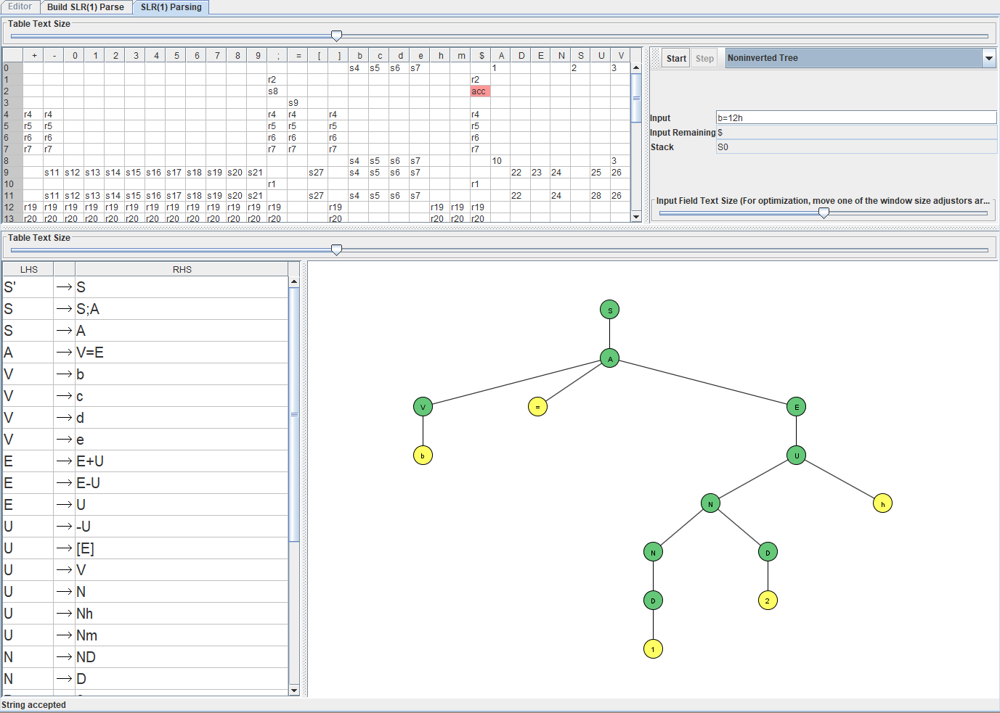

**2. `c=30m` — принято.** Проверена временная константа с единицей минут `m`.

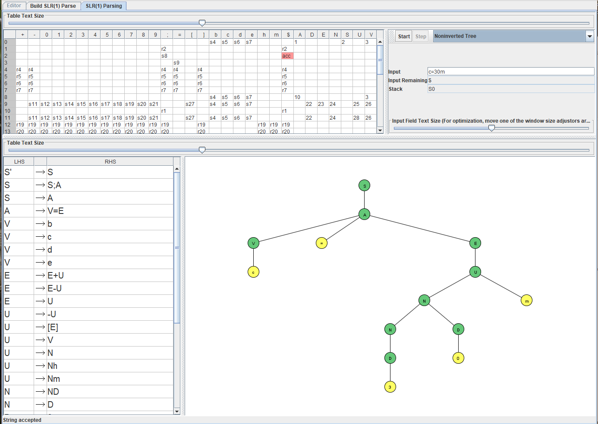

**3. `e=123` — принято.** Целое число выводится через повторение `N → ND`.

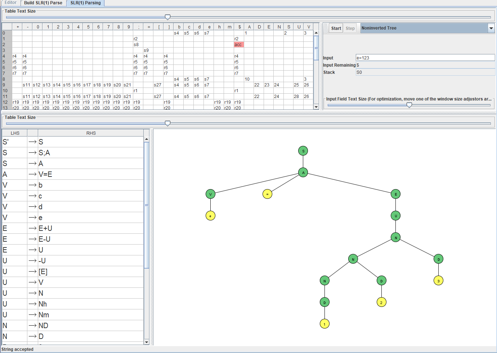

**4. `b=12h;c=1` — принято.** Два присваивания образуют последовательность `S → S;A`.

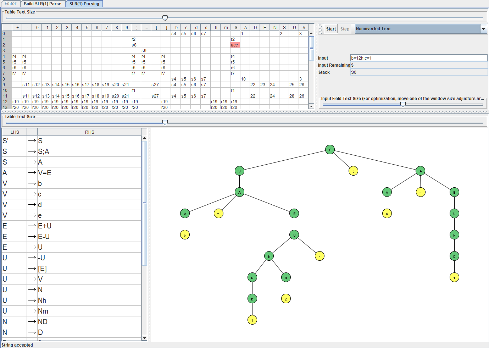

**5. `b=12s` — отклонено.** В грамматике отсутствует терминал единицы `s`.

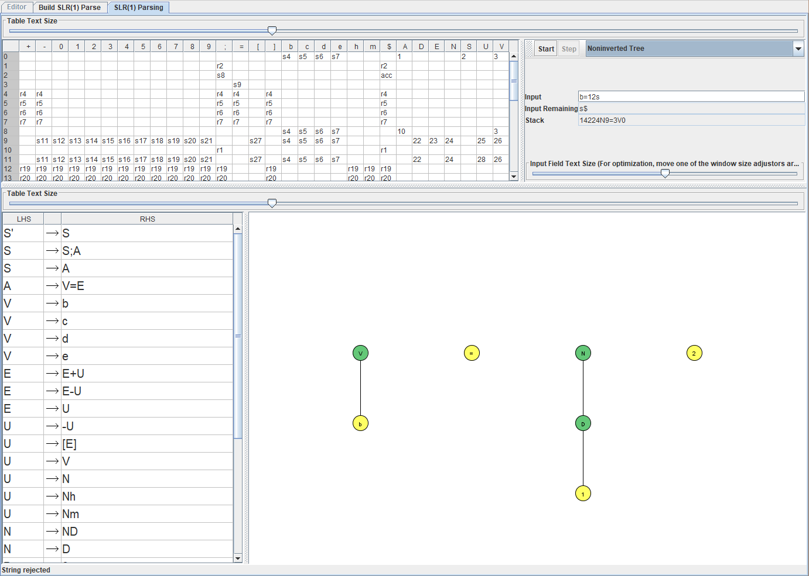

**6. `b=12h+` — отклонено.** После знака `+` отсутствует обязательный операнд `U`.

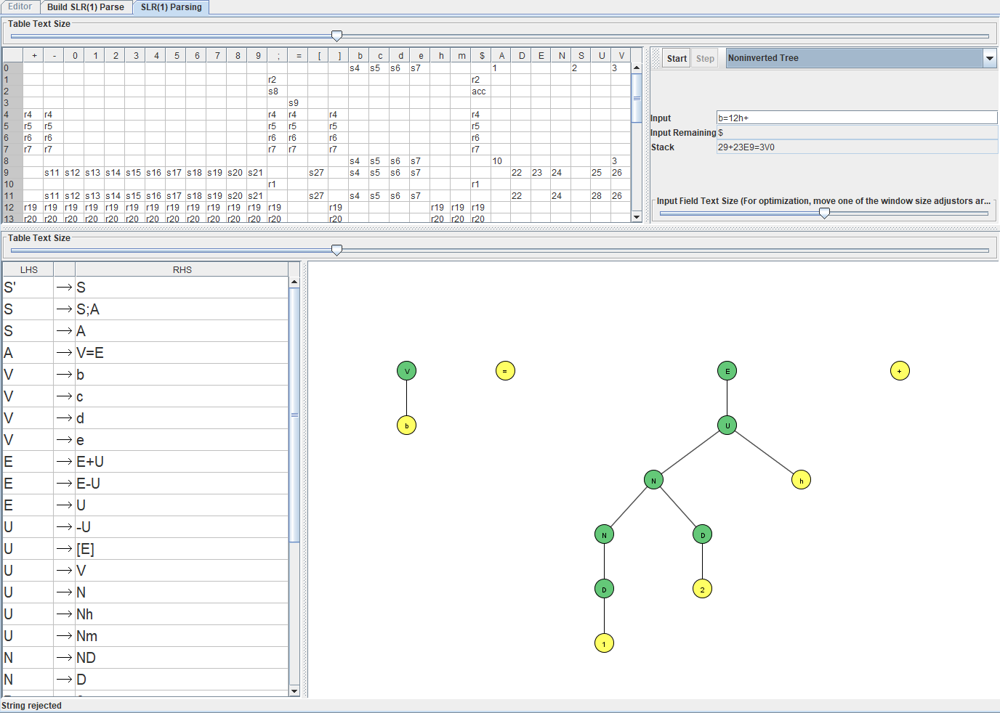

**FIRST, FOLLOW, LR(0)-автомат и таблица ACTION/GOTO в JFLAP:**

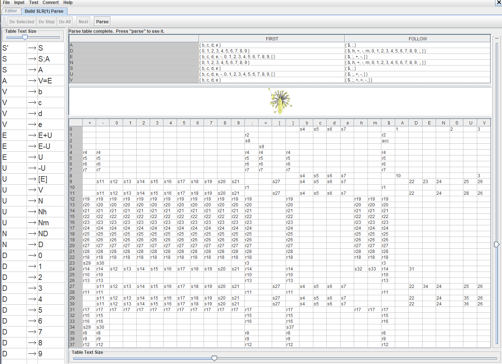

**Обоснование SLR(1):** канонический набор содержит 38 множеств LR(0)-ситуаций, и при заполнении `ACTION` на символах `FOLLOW` не возникает ни конфликтов «перенос/свёртка», ни конфликтов «свёртка/свёртка». Следовательно, данная грамматика принадлежит классу SLR(1). Шесть проверок в JFLAP дали ожидаемые результаты.

## 6. Вывод

Для варианта 8 построена LL(1)-грамматика одного оператора присваивания с временными значениями двух форматов; методом рекурсивного спуска реализован LL(1)-анализатор последовательностей выражений; построена отличная от первой SLR(1)-грамматика последовательностей присваиваний. Вычислены множества FIRST/FOLLOW, составлены таблицы LL(1) и SLR(1), построен канонический набор LR(0)-ситуаций. Проверено **6 цепочек LL(1)**, **12 цепочек Python** и **6 цепочек SLR(1)**. Для всех примеров результаты совпали с ожидаемыми. Бонусные задания не выполнялись.

## 7. Как запустить работу

1. **LL(1):** открыть `grammar_ll1.jff` в JFLAP 7.1, выбрать `Input → Build LL(1) Parse Table`, нажать `Do All`, затем `Parse`. Проверить цепочки из § 3.4.
2. **Рекурсивный спуск:** открыть терминал в папке `pr5` и выполнить `python recursive_descent.py -e "a=12:30"` либо запустить другие примеры из § 4.3.
3. **SLR(1):** открыть `grammar_slr1.jff`, выбрать `Input → Build SLR(1) Parse Table`, нажать `Do All`, затем `Parse`. Проверить цепочки из § 5.6.


